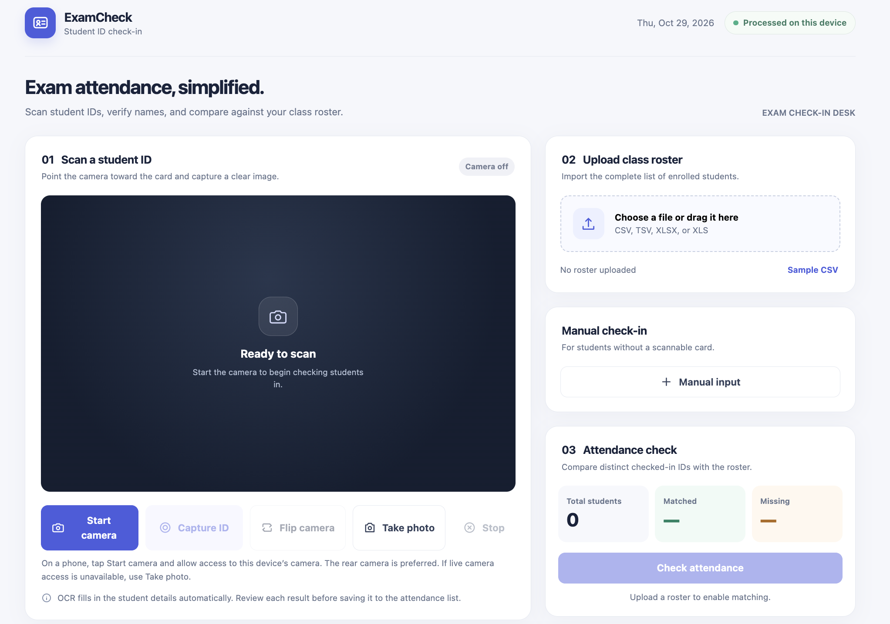
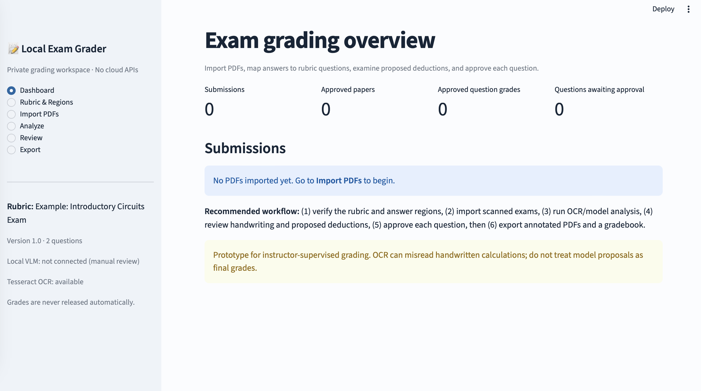

# ExamOps: Human-in-the-Loop Automation for Exam Administration

**Two working prototypes that automate exam check-in and build a foundation for AI-assisted grading of handwritten work.** Built to explore a practical question: *How do we turn imperfect AI perception into a reliable, auditable workflow that people can actually use?*

**Focus areas:** computer vision · document understanding · multimodal AI integration · workflow automation · human-in-the-loop systems · privacy-conscious engineering

> **Project status:** ExamCheck is a functional browser-based ID check-in app. Local Exam Grader is a functional local PDF-review, rubric-scoring, annotation, and export app. Its **local vision-language model (VLM) adapter is intentionally a template**; fully automatic interpretation of handwritten solutions is **not yet implemented**. These are currently **two separate applications**, not a synchronized platform.

## Demo at a glance

| ExamCheck — mobile-friendly student check-in | Local Exam Grader — annotated feedback |
|:--:|:--:|
|  |  |
| Camera capture, OCR review, roster reconciliation | Rubric-driven review, localized PDF comments, approved grading |

*All examples in this repository use synthetic or sample data; no real student submissions are included.*

## Why I built this

Exam administration involves a surprisingly large amount of repetitive work: checking student identities, reconciling attendance, reading scanned handwritten submissions, applying consistent point deductions, and returning annotated feedback.

Instead of treating an LLM as an opaque grader, I designed these applications around a **perceive → structure → decide → verify → export** pattern. AI can help extract or interpret messy inputs; deterministic software enforces the rules; and a person resolves ambiguous cases and approves consequential decisions.

This project demonstrates how I approach **end-to-end AI automation**: start from an operational bottleneck, build a usable interface, isolate uncertain model outputs, and make the workflow observable and correctable.

## 1 · ExamCheck — Student ID Scanner

**A responsive HTML/JavaScript check-in app designed for exam-room use on a phone or laptop.**


**Implemented**
- **Phone camera access:** requests the camera on the device running the webpage; prioritizes the rear camera, supports camera switching, and offers a native photo-picker fallback.
- **OCR-assisted data entry:** uses Tesseract.js in the browser to suggest the student's name and number, with an editable confirmation step before saving.
- **Roster reconciliation:** imports CSV/TSV/Excel rosters, matches student numbers, and shows total, checked-in, and missing students.
- **Operational edge cases:** manual check-in, duplicate-number warnings, searchable/scrollable records, missing-student list, and CSV attendance export.
- **Lightweight deployment:** single HTML file; no custom application backend required for single-device operation.

**Stack:** JavaScript, HTML/CSS, MediaDevices (`getUserMedia`), Tesseract.js, SheetJS.

**Key constraint:** Camera streaming on a phone generally requires HTTPS (or another secure context). The browser loads OCR/spreadsheet libraries from CDNs, but the app does not send roster content or captured images to an application server. Records are ephemeral and **do not sync between devices**.

## 2 · Local Exam Grader — Evidence-Based Grading Workflow

**A Python/Streamlit workspace for processing scanned PDFs, applying explicit deduction rubrics, and preparing reviewable feedback.**

**Implemented**
- **Batch PDF intake:** import scanned exam/homework PDFs, render pages, and crop configurable answer regions.
- **Configurable rubric:** structured JSON with question marks, solution references, deduction IDs, limits, and mutually exclusive rules.
- **Local processing:** optional Tesseract OCR hints; a clearly defined adapter for plugging in your own *local* multimodal model.
- **Deterministic grading logic:** validated rubric deductions and score calculation are handled by Python—not by trusting an LLM-generated final number.
- **Human approval:** inspect the source image, correct transcriptions, accept/reject deductions, provide feedback, override with a reason, and approve questions.
- **Traceable feedback:** PyMuPDF annotations map supported error locations to the original scanned pages; otherwise feedback is attached at question level.
- **Local records and export:** SQLite audit history, approved-grade CSV output, and downloadable annotated PDFs.

**Stack:** Python 3.10+, Streamlit, PyMuPDF, Pydantic, pandas, SQLite, optional Tesseract OCR.

**Current AI boundary:** `exam-grader/grader_core/local_llm_adapter.py` defines the prompt and expected structured output for a local VLM. Until you implement that adapter, **the app supports manual/instructor-supervised grading rather than automatic handwritten-solution grading**. No cloud model calls are included.

## Architecture & engineering decisions

```mermaid
flowchart TB
  subgraph A[ExamCheck — browser]
    A1[Phone camera / image] --> A2[Browser OCR]
    A2 --> A3[Human verification]
    A3 --> A4[Roster matching + deduplication]
    A4 --> A5[Attendance CSV]
  end
  subgraph B[Local Exam Grader — Python]
    B1[Scanned PDF + rubric] --> B2[Page rendering + answer crops]
    B2 --> B3[OCR hints / optional local VLM]
    B3 --> B4[Structured findings + validated rubric IDs]
    B4 --> B5[Deterministic deduction calculation]
    B5 --> B6[Instructor review + approval]
    B6 --> B7[Annotated PDF + gradebook]
  end
```



| Design choice | Why it matters in AI automation |
|---|---|
| **Separate perception from decisions** | OCR/model interpretation can fail without corrupting the business rules. |
| **Use explicit schemas and rubric IDs** | Model suggestions can be validated, rejected, and audited. |
| **Keep humans at uncertainty boundaries** | Ambiguous handwriting and high-impact grading decisions remain reviewable. |
| **Retain source evidence** | Every proposed error can be checked against the scanned page, not just an LLM explanation. |
| **Design for local execution** | Sensitive educational records can stay on the operator's machine. |

## Quick start

### A. Student ID scanner

```bash
cd id-scanner
python3 -m http.server 8000
```

Open **http://localhost:8000** on the host computer. To use the **phone's live camera**, serve the app at an HTTPS address accessible to that phone; an ordinary `http://192.168.x.x` LAN URL generally does not allow camera permissions. Upload `sample-student-roster.csv` to try roster matching.

### B. Local Exam Grader

Python **3.11 recommended** (3.10+ required).

```bash
cd exam-grader
python3.11 -m venv .venv
source .venv/bin/activate
python -m pip install -r requirements.txt
python -m streamlit run app.py
```

Open **http://localhost:8501**. Start with `examples/synthetic_exam.pdf` and `examples/rubric.json`. For Windows setup, see [`exam-grader/README.md`](exam-grader/README.md).

**To connect a local VLM:** implement `analyze_question(...)` in [`local_llm_adapter.py`](exam-grader/grader_core/local_llm_adapter.py), return the documented structured findings, and then set `MODEL_CONNECTED = True`. The model proposes evidence-backed rubric matches; a reviewer still approves the grade.

**Backend checks:** Five backend tests currently pass, covering rubric/scoring behavior, approval rules, annotation, and the no-model review path. These tests are not an accuracy benchmark for handwriting recognition.


```bash
cd exam-grader
python -m pip install pytest
python -m pytest -q
```

## Repository structure

```text
.
├── id-scanner/
│   ├── index.html                  # ExamCheck web app
│   └── sample-student-roster.csv
├── exam-grader/
│   ├── app.py                      # Streamlit review interface
│   ├── grader_core/
│   │   ├── local_llm_adapter.py    # Local VLM integration template
│   │   ├── grading.py             # Rubric validation + scoring
│   │   ├── pdf_tools.py           # Scanned PDF processing + annotations
│   │   └── ...
│   ├── examples/                   # Synthetic exam and sample rubric
│   ├── tests/
│   └── requirements.txt
├── assets/                         # Real app / synthetic example screenshots
└── README.md
```

